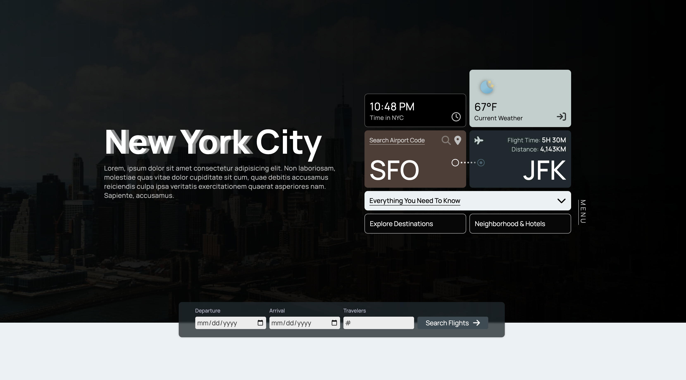

# NYC Travel Guide

A travel guide landing page for New York City, with live NYC time and weather, flight times from your airport, top destinations and a neighborhood and hotel guide.

**[Live site](https://nyc.aniqa.dev)**

<a href="https://nyc.aniqa.dev"></a>

## Tech

- HTML, CSS and JavaScript
- OpenWeather API for current NYC weather
- DistanceTo API (through RapidAPI) for flight times and distance
- Hotel, neighborhood and weather icon data in local JSON files

## Features

- A widget-style hero with the live time and weather in New York, linking to my [weather dashboard](https://weather.aniqa.dev) for the full forecast
- Flight time and distance to JFK: type a 3-letter airport code or use your location, and your last search is remembered
- Six top destinations, from the Empire State Building to the High Line, each with a map you can toggle in place
- A neighborhood guide for Uptown, Midtown and Downtown, each with nine hotels to switch between (photo, address, phone and booking link)
- A sign-up form at the end that politely admits there are no reservations to take

## Design

- A muted palette with grid and flexbox layouts in every section
- Destination cards sit in a horizontal scroll container
- Subtle hover transitions on buttons and images, with five breakpoints for phones through desktops

## Accessibility

- Icon-only buttons and links (airport search, location, social links) have screen reader labels
- Images have alt text, including weather icons and hotel photos when you switch hotels

## Project structure

- `index.html`: the page
- `index.js`: time, weather, flight search, map toggles, hotel switching and the form
- `styles.css`: layout and breakpoints
- `content/`: `hotels.json` (27 hotels), `neighborhood.json` and `weather.json` (condition-to-icon mapping)
- `assets/`: photos, hotel images and weather icons

## Key concepts

- **Content from JSON.** Hotels, neighborhoods and weather icons load from files I compiled, so the page updates by editing data instead of markup.
- **Two APIs side by side.** Weather loads on page load; flight data loads on search, using either an airport code or coordinates from the Geolocation API.
- **A live clock** in New York time, updated every second with `setInterval`.
- **Writing help.** The descriptive copy was drafted with ChatGPT.

## Setup

Requires an [OpenWeather](https://openweathermap.org/api) key and a [RapidAPI](https://rapidapi.com/) key subscribed to DistanceTo. Replace the two placeholders in `index.js`:

| Placeholder | Key |
| --- | --- |
| `ADD OPENWEATHER KEY HERE` | OpenWeather API key |
| `ADD DISTANCETO KEY HERE` | RapidAPI key with DistanceTo |

Then serve the folder locally, since the page loads its JSON with `fetch`:

```bash
git clone https://github.com/aniqatc/nyc-travel.git
cd nyc-travel
python3 -m http.server
```

## Changelog

### September 2024

- Improved mobile layouts for the neighborhood and destination cards

### November 2023

- Cleaned up the code and moved data fetching to async functions

### September 2023

- Initial release
